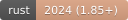
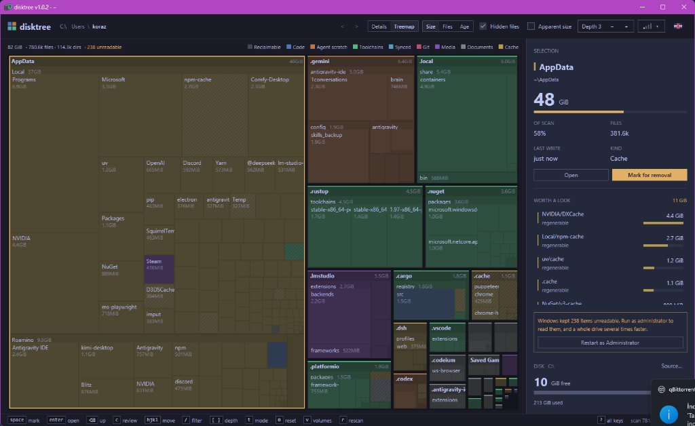
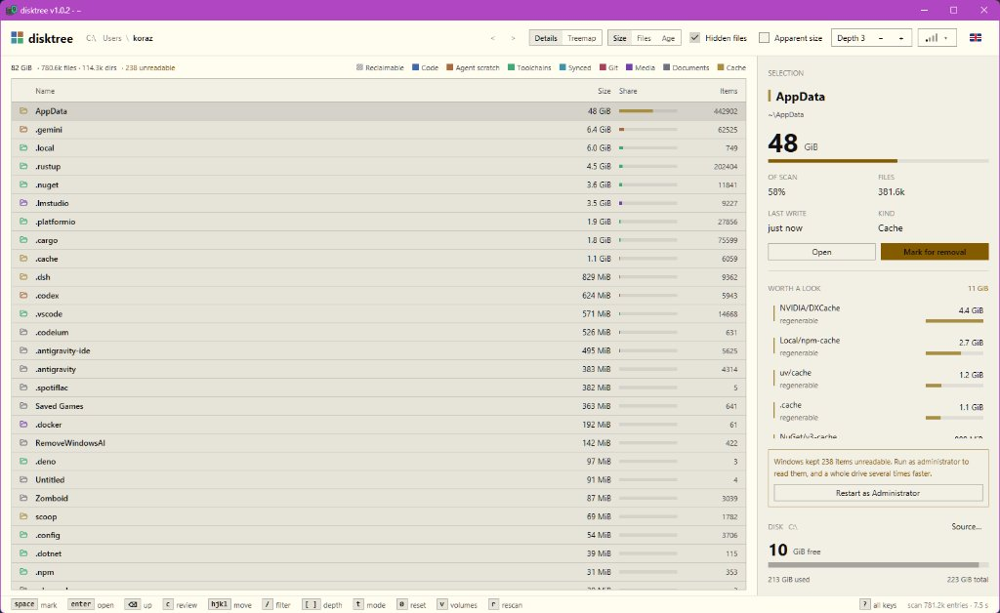
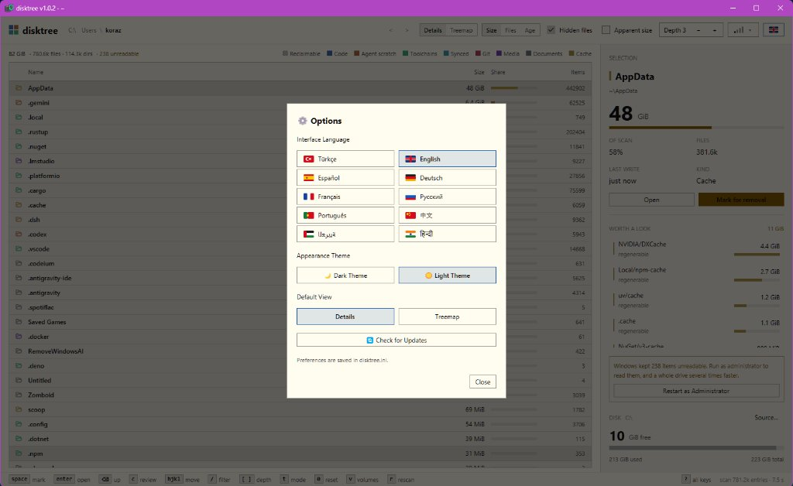

<div align="center">


# DiskHaY

**GPU-Accelerated Interactive Disk Space Visualizer & Cleaner**  
*GPU Hızlandırmalı İnteraktif Disk Alanı Görselleştirici ve Temizleyici*

[](https://github.com/HaYToKoRaZ/DiskHaY/releases)
[](https://github.com/HaYToKoRaZ/DiskHaY/actions)
[](https://github.com/HaYToKoRaZ/DiskHaY/releases)
[](https://www.rust-lang.org/)
[](https://gpui-kit.com/)
[](#-supported-languages--desteklenen-diller)
[](LICENSE)

<br/>

<a href="#english"> <b>English</b></a>
&nbsp;&nbsp;•&nbsp;&nbsp;
<a href="#turkce"> <b>Türkçe</b></a>

<br/><br/>

<table>
  <tr>
    <td align="center">
      <a href="assets/screenshots/treemap-dark.jpg">
        
      </a><br/>
      <sub><b>Treemap • Dark Theme</b> / <i>Mozaik • Koyu Tema</i></sub>
    </td>
    <td align="center">
      <a href="assets/screenshots/details-light.jpg">
        
      </a><br/>
      <sub><b>Details • Light Theme</b> / <i>Ayrıntılar • Açık Tema</i></sub>
    </td>
    <td align="center">
      <a href="assets/screenshots/options-light.jpg">
        
      </a><br/>
      <sub><b>Options • 10 Languages</b> / <i>Seçenekler • 10 Dil</i></sub>
    </td>
  </tr>
</table>
<sub><i>Click any screenshot to view full size / Tam boyut için görsellere tıklayın</i></sub>

</div>

---

<a id="english"></a>
##  English

DiskHaY is a high-performance, GPU-accelerated disk space analyzer built with **Rust** and **GPUI**. It visually represents disk usage as an interactive treemap mosaic or detailed list sized strictly by real disk allocation (`st_blocks * 512`), allowing you to find what is consuming space, stage items for safe cleanup, and inspect storage in real-time.

### ✨ Key Features

- **⚡ Blazing Fast & Lightweight:** Built in Rust with GPU-accelerated rendering via GPUI. Smooth 60+ FPS navigation even with millions of indexed files.
- **🗺️ Dual Views (Treemap & Details):** Switch instantly between the interactive mosaic treemap and the sortable details table right from the top bar.
- **📏 Real Disk Cost (Allocation-Aware):** Respects actual filesystem block usage (`st_blocks * 512`) rather than superficial file lengths.
- **🛡️ Safe Staged Cleanup:** No files are deleted until you review and confirm. Root drives, system mounts, and user profile roots are strictly protected against accidental deletion.
- **🌍 10 Built-in Languages:** Native localization with vector flags, plus Dark & Light theme switching saved in `diskhay.ini`.
- **🔄 Automatic Update Checker:** Checks GitHub Releases non-blockingly at startup and informs you when an update is available.
- **📦 Cross-Platform Packages:** Pre-built Windows Installer (`.exe`), Windows Portable (`.zip`), and Linux x86_64 (`.tar.gz`) releases.

---

### 📥 Download & Installation

Visit the [**Latest Releases**](https://github.com/HaYToKoRaZ/DiskHaY/releases) page to download:

| Platform | Package | File | Description |
| :--- | :--- | :--- | :--- |
| **Windows x64** | **Setup (Recommended)** | `diskhay-v1.0.4-windows-x64-setup.exe` | Standard Windows installer with desktop shortcut and uninstall support. |
| **Windows x64** | **Portable** | `diskhay-v1.0.4-windows-x64-portable.zip` | Standalone archive. Extract anywhere and launch `diskhay.exe`. |
| **Linux x86_64** | **Tarball** | `diskhay-v1.0.4-x86_64-linux.tar.gz` | Extract and run `./install.sh` to install binary, icon, and `.desktop` entry. |

SHA256 checksums (`.sha256`) are provided alongside each asset for file integrity verification.

---

### ⌨️ Keyboard & Mouse Controls

| Input | Action |
| :--- | :--- |
| **Click / Hover** | Select and inspect directory or file details in the side panel |
| **Double Click / Enter** | Zoom into selected directory |
| **Backspace / Esc** | Zoom out / go to parent directory |
| **Spacebar / Right Click** | Mark / unmark selected file or directory for deletion |
| **C** | Open staged cleanup review modal |
| **R / F5** | Rescan directory or drive |
| **?** | Show all keyboard shortcuts |

---

### 🛠️ Building from Source

**Prerequisites:**
- [Rust](https://rustup.rs/) (edition 2024, toolchain 1.85+)
- Visual Studio C++ Build Tools (Windows) or X11/Wayland/Vulkan dev libraries (Linux)

```powershell
# Clone repository
git clone https://github.com/HaYToKoRaZ/DiskHaY.git
cd disktree/main

# Run debug build
cargo run --bin diskhay

# Build optimized release binary
cargo build --release -p disktree-app
```

---

<br/>

<a id="turkce"></a>
##  Türkçe

DiskHaY, **Rust** ve **GPUI** ile geliştirilmiş, GPU hızlandırmalı, yüksek performanslı bir disk alanı analiz ve temizleme aracıdır. Disk kullanımını gerçek disk blok tahsisatına (`st_blocks * 512`) göre boyutlandırılmış dinamik bir mozaik (treemap) veya ayrıntılı liste olarak görselleştirir. Nelerin yer kapladığını hızla bulmanızı, güvenle işaretleyip temizlemenizi sağlar.

### ✨ Temel Özellikler

- **⚡ Yüksek Performans ve Düşük Bellek:** GPUI motoru ile doğrudan ekran kartı üzerinden 60+ FPS akıcı arayüz. Milyonlarca dosya içeren dizinlerde bile anında gezinme.
- **🗺️ Çift Görünüm (Mozaik & Ayrıntılar):** Üst çubuktan tek tıkla interaktif mozaik harita ile sıralanabilir ayrıntılar listesi arasında geçiş.
- **📏 Gerçek Disk Tahsisi:** Dosyaların boyutu sadece metin uzunluğuna göre değil, disk üzerinde kapladığı gerçek sektör/blok maliyetine (`st_blocks * 512`) göre hesaplanır.
- **🛡️ Güvenli Silme Koruması:** Hiçbir dosya siz onay vermeden doğrudan silinmez. Taranan kök sürücü, sistem bağlama noktaları ve kullanıcı profil klasörleri yanlışlıkla silinmeye karşı korumalıdır.
- **🌍 10 Dil Desteği ve Tema:** Vektörel bayrak ikonlarıyla donatılmış 10 dil desteği ile `diskhay.ini` üzerinden kaydedilen Koyu/Açık tema seçimi.
- **🔄 Otomatik Güncelleme Kontrolü:** Başlangıçta arka planda yeni sürüm olup olmadığını kontrol eder ve bilgilendirir.
- **📦 Çoklu Platform Paketleri:** Windows Kurulum (`.exe`), Windows Taşınabilir (`.zip`) ve Linux x86_64 (`.tar.gz`) sürümleri.

---

### 📥 İndirme ve Kurulum

En son sürümü indirmek için [**GitHub Releases**](https://github.com/HaYToKoRaZ/DiskHaY/releases) sayfasını ziyaret edin:

| Platform | Paket | Dosya | Açıklama |
| :--- | :--- | :--- | :--- |
| **Windows x64** | **Kurulum (Önerilen)** | `diskhay-v1.0.4-windows-x64-setup.exe` | Masaüstü kısayolu ve kaldırma yöneticisi içeren standart Windows kurulumu. |
| **Windows x64** | **Taşınabilir (Portable)** | `diskhay-v1.0.4-windows-x64-portable.zip` | Kurulum gerektirmez. ZIP'ten çıkarıp doğrudan `diskhay.exe` dosyasını çalıştırın. |
| **Linux x86_64** | **Arşiv (Tarball)** | `diskhay-v1.0.4-x86_64-linux.tar.gz` | Arşivi açıp `./install.sh` çalıştırarak ikili dosyayı, ikonu ve masaüstü girişini kurun. |

Her dosya için SHA256 doğrulama kodları (`.sha256`) yayın sayfasında mevcuttur.

---

### ⌨️ Kısayollar ve Kontroller

| Girdi | İşlem |
| :--- | :--- |
| **Tıklama / Vurgu** | Klasör veya dosyayı seçip yan panelde ayrıntılarını görüntüleme |
| **Çift Tıklama / Enter** | Seçili klasörün içine odaklanma (Zoom in) |
| **Geri Tuşu / Esc** | Bir üst klasöre çıkma (Zoom out) |
| **Boşluk / Sağ Tık** | Dosyayı/klasörü silinmek üzere listeye ekleme / çıkarma |
| **C** | Silinmek üzere seçilen öğeleri gözden geçirme penceresini açma |
| **R / F5** | Diski veya dizini yeniden tarama |
| **?** | Tüm klavye kısayollarını gösterme |

---

### 🛠️ Kaynak Koddan Derleme

**Gereksinimler:**
- [Rust](https://rustup.rs/) (2024 sürümü, Rust 1.85+)
- Visual Studio C++ Derleme Araçları (Windows) veya X11/Wayland/Vulkan geliştirme kütüphaneleri (Linux)

```powershell
# Depoyu klonlayın
git clone https://github.com/HaYToKoRaZ/DiskHaY.git
cd disktree/main

# Geliştirici modunda çalıştırın
cargo run --bin diskhay

# Dağıtım için optimize release sürümü derleyin
cargo build --release -p disktree-app
```

---

<br/>

## 🌐 Supported Languages / Desteklenen Diller

DiskHaY 10 dilde yerel arayüz desteği sunar / DiskHaY provides native localized UI in 10 languages:

| Dil / Language | Kod / Code | Dil / Language | Kod / Code |
| :--- | :--- | :--- | :--- |
|  Türkçe | `tr` |  English | `en` |
|  Español | `es` |  Deutsch | `de` |
|  Français | `fr` |  Русский | `ru` |
|  Português | `pt` |  中文 | `zh` |
|  العربية | `ar` |  हिन्दी | `hi` |

---

## 📄 License / Lisans

Bu proje **MIT** lisansı altında dağıtılmaktadır. / This project is licensed under the **MIT License**.  
Detaylar için [LICENSE](LICENSE) dosyasına göz atabilirsiniz.
